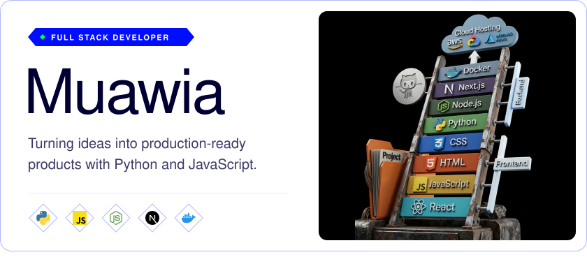
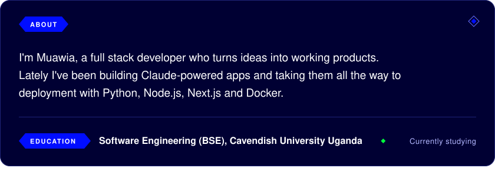
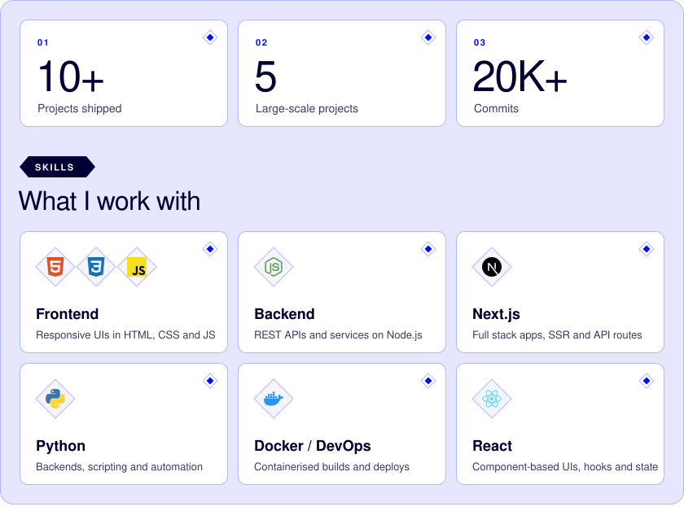
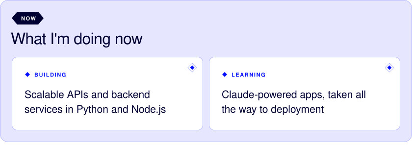
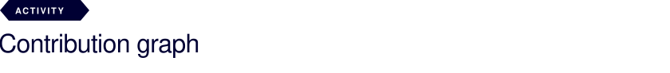
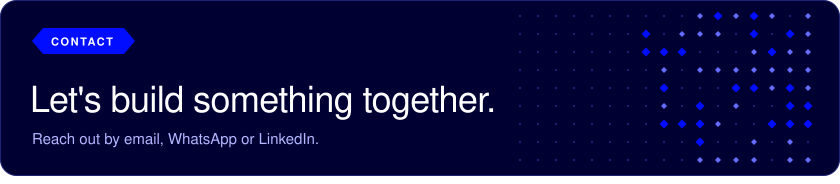
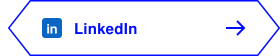

 

  

 

 

 

 
<picture><source media="(prefers-color-scheme: dark)" srcset="assets/activity-dark.svg"></picture>
 
<picture>
  <source media="(prefers-color-scheme: dark)" srcset="https://raw.githubusercontent.com/Muawiase/muawiase/output/snake-dark.svg">
  
</picture>
  

 

